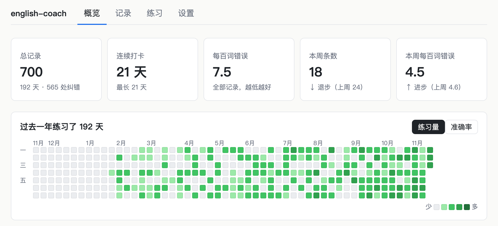
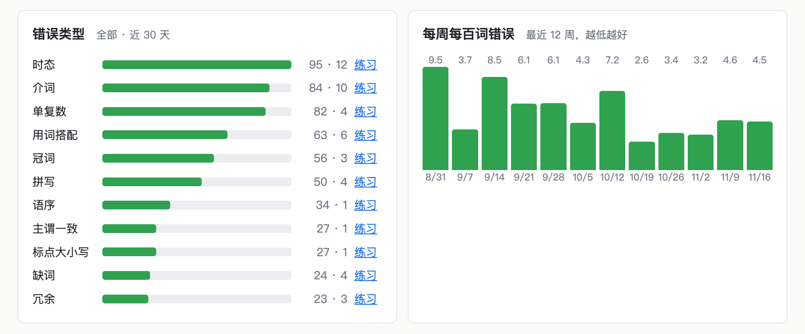
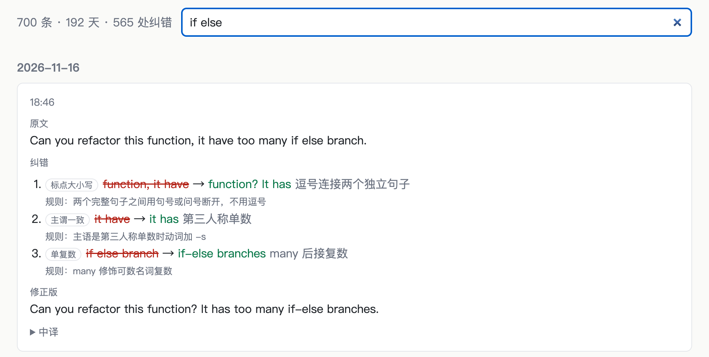
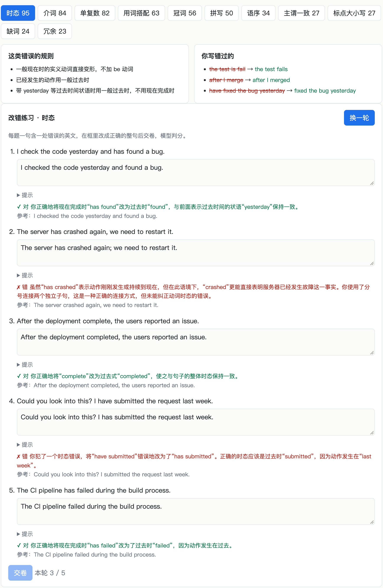

<h1 align="center">english-coach</h1>

<p align="center">
  <b>在 Claude Code 里写英文 prompt，顺手把英文练好。</b><br>
  英文 prompt 自动纠错 · 错误按语法分类 · 打卡网格看进步 · 照你自己的错出题练
</p>

<p align="center">
  <i>A Claude Code plugin that turns the English prompts you write into grammar lessons — with a streak heatmap, error analytics and drills built from your own mistakes. Feedback in Chinese.</i>
</p>

<p align="center">
  
  
  
  
  
</p>

<p align="center">
  
</p>

```bash
claude plugin marketplace add cognirail/english-coach
claude plugin install english-coach@english-coach
```

再[配一个 key](#快速开始)，新开会话就生效。

## 为什么做它

给中文母语的开发者：每天和 AI 用英文协作几十条消息，本来就是最好的写作练习，缺的只是有人帮你改、帮你记、帮你复盘。

- **不换工具**：照常在 Claude Code 里写英文，[符合条件](#哪些输入不纠错)的 prompt 自动纠错。
- **提交时就给修正版**：hook 同步等短改写（模型超时 7 秒；历史热连接实测约 1 秒，实际看模型和网络），修正版显示给你，同时作为旁注给 Claude，它更懂你想说什么。
- **错在哪、为什么错**：每处纠错标出分类（时态 · 冠词 · 介词…）和一句可推广的语法规则。
- **看得见进步**：打卡网格、每百词错误、12 周趋势，错误率降下来是能看到的。
- **专攻弱项**：挑错得最多的那一类，模型照你写错过的句子出改错题，判分并累计正确率。

## 你会看到什么

**写英文 prompt 时**，Claude Code 里多出一条提示：

```
english-coach 修正版：
Can you refactor this function? It has too many if-else branches.
完整反馈：file:///Users/you/.english-coach/open.html
```

末行是本地看板的链接，终端里 ⌘ 点开（或输入 `/english-coach:dashboard`）：

<table>
  <tr>
    <td width="50%"><b>错误分布与趋势</b><br>哪类错最多、近 30 天还在犯什么、每周错误率往哪走<br><br></td>
    <td width="50%"><b>每条记录</b><br>原文 → 纠错（分类 + 规则）→ 修正版 → 中译，可搜索<br><br></td>
  </tr>
</table>

**专项练习**：按分类出最多 5 道改错题，交卷由模型判分并讲解，正确率按类累计。

<p align="center">
  
</p>

<sub>截图均为虚构的演示数据。</sub>

## 快速开始

需要：macOS · Node.js ≥ 24（插件直接运行 TypeScript，不用装依赖）· 一个有额度的模型 API key。每条纠错调用两次模型（短改写 + 完整反馈），练习的出题和判分另计。

**1. 安装插件**（终端里执行；也可以在 Claude Code 里输入 `/plugin marketplace add cognirail/english-coach`，再用 `/plugin` 安装）

```bash
claude plugin marketplace add cognirail/english-coach
claude plugin install english-coach@english-coach
```

**2. 配 key**：默认走 Anthropic API，模型 `claude-haiku-5-5`。Claude Code 的订阅登录（Pro / Max）**不是** API key，要另在 [Claude Console](https://platform.claude.com/) 建一个，然后存进 Keychain（命令会提示你粘贴 key，key 不落任何文件）：

```bash
security add-generic-password -s english-coach -a anthropic -w
```

不想用 Keychain，也可以在启动 Claude Code 的 shell 里设 `ANTHROPIC_API_KEY`。查找顺序：Keychain → 环境变量。想用 OpenAI 或兼容网关，见[换模型通道](#换模型通道)。

**3. 新开一个 Claude Code 会话**，用英文写一条不少于 8 个词的 prompt。短改写返回后你会看到：

```
english-coach 修正版：
Can you refactor this function? It has too many if-else branches.
完整反馈：file:///Users/you/.english-coach/open.html
```

没看到？输入 `/english-coach:dashboard` 打开看板（链接点不开时也用它），在「设置」页点「连通测试」；日志在 `~/.english-coach/logs/daemon.log`。

**4. 日常使用**

| 想做什么             | 怎么做                                                                                        |
| -------------------- | --------------------------------------------------------------------------------------------- |
| 看打卡、错误分布     | 点提示末行的链接，或 `/english-coach:dashboard` → 概览                                        |
| 翻某条记录的详细讲解 | 看板 → 记录，可按日期筛选、按原文 / 规则搜索                                                  |
| 专攻一类错误         | 看板 → 练习，或在概览的错误类型旁点「练习」                                                   |
| 暂时不想被纠错       | 看板 → 设置 → 关闭，或 `touch ~/.english-coach/disabled`（`rm` 掉即恢复）                     |
| 卸载                 | `claude plugin uninstall english-coach@english-coach`；记录在 `~/.english-coach/`，要删自己删 |

### 哪些输入不纠错

- 斜杠命令、带代码块的、超过 8 行或 1500 字符的、不到 8 个英文词的
- 中文占比高的：汉字数 ÷ 2 估作中文词数，占中英文总词数超过 30% 就跳过
- 识别为终端粘贴的：多行时超过半数行像命令或输出；单行要以 `$` `❯` `%` 提示符开头（不带提示符的单行命令，满足其他条件时照常纠错）

## 隐私

- 插件不经过作者运营的任何服务器。要纠错的 prompt 原文、练习用的历史错例和你的作答，会发给**你配置**的模型服务（默认 Anthropic；接网关时还经过网关），上游怎么留存由服务商的政策决定。
- 插件自己的记录只存在本机 `~/.english-coach/`，目录权限 700。
- key 只从 macOS Keychain 或环境变量读，不写进任何文件；看板只监听 127.0.0.1，带随机 token。

## 一条消息发生什么

```
你发英文 prompt
  → UserPromptSubmit hook 交给本机常驻 daemon（unix socket，毫秒级）
  → 跳过规则（见「哪些输入不纠错」）· 非人输入
  → 同步：短改写（只修语法、去冗余，不改句序不删信息），模型超时 7 秒
      Claude 收到原文 + 修正版旁注（冲突以原文为准）；你在 systemMessage 里看到修正版和看板链接
  → 脱离：完整反馈（原文中译 · 纠错列表，每条带分类与一句语法规则 · 修正版 · 修正版中译）追加到 ~/.english-coach/records/<日期>.jsonl
```

看板四页（只监听 127.0.0.1，随会话启动常驻）：

| 页面 | 内容                                                                                                                            |
| ---- | ------------------------------------------------------------------------------------------------------------------------------- |
| 概览 | 总记录 · 连续打卡 · 每百词错误 · 本周对比；一年打卡网格（练习量 / 每百词错误数，界面上标为「准确率」）；错误类型分布；12 周趋势 |
| 记录 | 按天分组的全部纠错，每条标分类与语法规则；按日期筛选、按原文 / 纠错 / 规则搜索                                                  |
| 练习 | 选一个错误类型 → 看规则与你的错例 → 出最多 5 道改错题 → 交卷判分，正确率按类型累计                                              |
| 设置 | 临时开关 · 后台进程状态与重启 · key 来源 · 连通测试 · 模型通道配置（保存即重启后台进程）                                        |

每百词错误数口径（界面上标为「准确率」）：每百个英文词的纠错数，越低越好；只算拿到完整反馈的记录，原文里夹的中文片段被「翻译」不算英文错误，现行跳过规则会跳过的旧记录（如粘贴的命令）不进统计和练习。

从 0.2 升级：旧记录没有错误分类，跑一次迁移补上。脚本在已安装的插件目录里，每条记录调用一次模型：

```bash
node "$(ls -td ~/.claude/plugins/cache/english-coach/english-coach/*/ | head -1)daemon/backfill.ts"
```

改前原分片备份到 `records/.backup-0.3/`。迁移期间会先停掉 daemon，这段时间写的 prompt 不纠错，结束后下一条自动恢复。

## 换模型通道

默认 Anthropic；也可改用 OpenAI，或 OpenAI 兼容端点（OpenRouter、自建网关）。兼容端点须是 HTTPS，支持 `/chat/completions` 和 `max_completion_tokens` 参数：

写 `~/.english-coach/config.json`：

```json
{ "provider": "openai", "model": "<模型名>" }
```

key 存 `security add-generic-password -s english-coach -a openai -w`，或设 `OPENAI_API_KEY`。接 OpenRouter、自建网关等兼容端点时再加 `"baseUrl": "https://<host>/v1"`。

也可以在看板「设置」页改，保存时校验并重启后台进程。设置页不接收也不显示 key。全部字段：

| 字段              | 默认                                                      | 说明                        |
| ----------------- | --------------------------------------------------------- | --------------------------- |
| `provider`        | `anthropic`                                               | `anthropic` 或 `openai`     |
| `model`           | `claude-haiku-5-5`                                        | `openai` 时必填             |
| `baseUrl`         | `https://api.anthropic.com` / `https://api.openai.com/v1` | 兼容端点改这里              |
| `keychainService` | `english-coach`                                           | Keychain 条目的 service     |
| `keychainAccount` | 同 `provider`                                             | Keychain 条目的 account     |
| `envKey`          | `ANTHROPIC_API_KEY` / `OPENAI_API_KEY`                    | Keychain 没有时读的环境变量 |

手改配置文件后在设置页点「重启」。

## 开关

| 方式        | 命令                                                    | 生效       |
| ----------- | ------------------------------------------------------- | ---------- |
| 临时关 / 开 | 设置页按钮，或 `touch` / `rm ~/.english-coach/disabled` | 下一条消息 |
| 停用插件    | `claude plugin disable english-coach@english-coach`     | 新会话     |

## 失效行为

- daemon 不在：hook 先拉起一次（等约 3 秒）再重试；daemon 在但 9 秒没回应、或重试仍失败：只输出一条提示，prompt 照常发给 Claude。整条 hook 最坏约 13 秒，在 Claude Code 给的 15 秒内。
- key 读不到 / API 出错 / 7 秒超时：只提示失败原因，不附修正版。
- 完整反馈生成失败：记录照写，带 `error` 字段；模型返回的不是合法 JSON：原文存进 `raw` 字段，页面里可展开看。

## 数据

```
~/.english-coach/
├── config.json             # 可选
├── records/<日期>.jsonl    # 每条一行，只追加
├── practice/<日期>.jsonl   # 练习，每轮一行，只追加
├── daemon.sock             # 唯一事实：谁在这个路径上应答谁就是 daemon
├── ui.json                 # 看板地址与访问 token（600），看板换新进程即失效
├── open.html               # 看板跳转页（600），提示末行链接指向它；token 不进命令行参数和终端输出
└── logs/{daemon,ui}.log
```

记录格式见 `daemon/daemon.ts` 的 `CoachRecord`。

## 开发

```bash
pnpm install
pnpm test && pnpm lint && pnpm typecheck
ENGLISH_COACH_HOME=/tmp/ec node ui/server.ts   # 用临时数据目录起看板，不碰真实记录
claude --plugin-dir .        # 不安装，直接加载本地插件
```

## License

MIT
